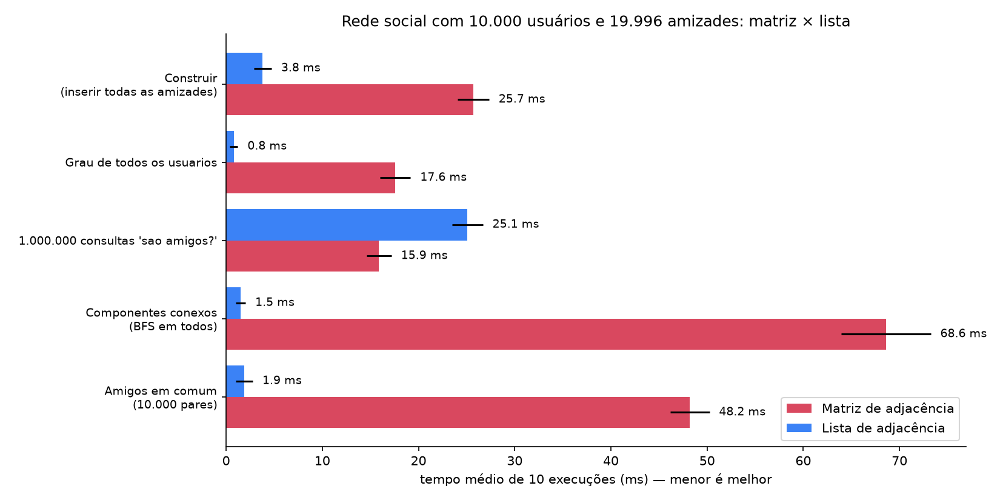
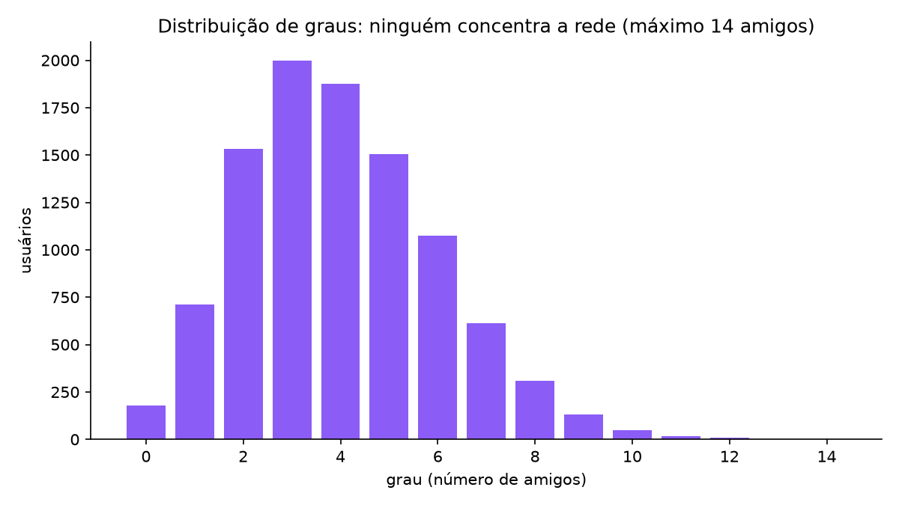

# Atividade de grafos — rede social em matriz e lista de adjacência (C)

Enunciado (slide 75 do deck "8. Grafos"): implementar um grafo em C com **matriz** e **lista de adjacência**, popular com
`usuários rede social` (10.000 usuários) e `amizades rede social` (19.998 linhas), **comparar o tempo de processamento** e
apresentar em videocast as implementações e uma **análise da rede** (usuários mais influentes, interesses em comum etc.).

## Como rodar

```bat
build.bat            :: MSVC /O2 /W4 /WX  (build.bat asan = AddressSanitizer)
bin\testes.exe       :: 46 verificações
bin\rede.exe         :: benchmark + análise; lê ..\..\atividade de grafos (ou passe a pasta)
uv run --with matplotlib python tools\graficos.py   :: gráficos para o vídeo
```
Com gcc/clang: `make` e `make asan`. Opções: `rede.exe <pasta> --repeticoes 10 --sem-bench`.

## Estrutura

| Arquivo | O que faz |
|---|---|
| `src/dados.c` | Lê os CSV com `fgets` (campo de tópicos entre aspas: `"Esportes, Saúde, Tecnologia"`), guarda os tópicos como bits (`uint16_t`) e abre caminho com acento via `_wfopen` no Windows |
| `src/grafo_matriz.c` | Matriz `n×n` de bytes, simétrica; inserir/consultar O(1), grau e vizinhos O(n), BFS O(n²) |
| `src/grafo_lista.c` | Vetor de listas encadeadas + grau guardado; inserir O(grau) (checa repetida), consultar O(grau), BFS O(n+m) |
| `src/bench.c` | Mede as mesmas 5 operações nas duas estruturas, 10 repetições, média ± desvio, e confere que os resultados são iguais |
| `src/analise.c` | Grau, componentes (BFS), graus de separação, PageRank, correlação, interesses (homofilia, Jaccard), grupos e sugestões de amizade, triângulos |
| `tests/testes.c` | Grafo pequeno do slide (A–B, B–C, B–D, E–F) + conferência matriz × lista nos dados reais |

## Resultados (Windows, MSVC /O2, média de 10 execuções)

| Operação | Matriz | Lista | Quem ganha |
|---|---|---|---|
| Construir (inserir 19.998 amizades) | 25,7 ms | 3,8 ms | lista 6,8× |
| Grau de todos os usuários | 17,6 ms | 0,8 ms | lista 22× |
| 1.000.000 consultas "são amigos?" | **15,9 ms** | 25,1 ms | **matriz 1,6×** |
| Componentes conexos (BFS em todos) | 68,6 ms | 1,5 ms | lista 46× |
| Amigos em comum (10.000 pares) | 48,2 ms | 1,9 ms | lista 25× |
| Memória | 95,4 MB | 0,72 MB | lista 132× menos |



**Leitura:** a rede é esparsa (densidade 0,04%: cada usuário tem 4 amigos em média entre 9.999 possíveis). A matriz
gasta n² = 100 milhões de células para guardar 39.992 uns e, em toda operação que percorre vizinhos, olha as 10.000
colunas de cada linha. A lista só visita amigos de verdade (O(n + m)). A única vitória da matriz é a pergunta "a e b são
amigos?", que nela é um acesso direto O(1) e na lista exige percorrer até 14 nós. Conclusão: **para rede social, lista**;
matriz só compensa em grafo denso ou quando a operação dominante é testar aresta.

Cuidados de medição: a leitura dos arquivos (≈10 ms) ficou fora do tempo; as entradas aleatórias usam semente fixa e são
as mesmas nas duas estruturas; metade das consultas são amizades reais; cada operação devolve um checksum (e o programa
confere que matriz e lista dão o mesmo resultado). `clock()` no Windows tem resolução de ~1 ms, então os tempos da lista
abaixo de 2 ms têm erro relativo alto — a ordem de grandeza é o que importa. A dica do slide cita `timer.h`; o `clock()`
fica em `<time.h>`.

## Análise da rede

- **Tamanho:** 10.000 usuários, 19.996 amizades únicas (o arquivo tem **2 pares repetidos**, que a lista precisa ignorar e a matriz ignora sozinha), grau médio 4,0, máximo 14, **177 usuários sem nenhum amigo**.
- **Conexão:** 182 componentes; o maior tem 9.815 usuários (98,2%). Graus de separação no maior componente: **6,7 em média** (amostra de 200 origens), máximo visto 12 — o "mundo pequeno" dos seis graus.
- **Mais influentes** (grau; empate pelo PageRank): 1º martin574 (14 amigos, PageRank 3,1× a média), 2º kaitlyn261 (14), 3º marc167 (13). Ranking completo dos 100 primeiros em `resultados/ranking.csv`. O PageRank e o grau concordam no topo.
- **Postar mais não dá mais amigos:** correlação grau × postes = 0,001; grau × tempo na rede = −0,001.
- **Interesses:** 10 tópicos, cada um com ~2.000 usuários. 37,1% das amizades têm ao menos 1 tópico em comum, contra 36,9% de pares sorteados ao acaso; Jaccard médio 0,132 × 0,130. **Não há homofilia**: as amizades desta base não seguem os interesses. Com só **7 triângulos** em toda a rede, o grafo se comporta como gerado ao acaso (redes reais têm muitos triângulos). Isso é um achado para a análise crítica, não um erro do programa.
- **Interesses idênticos:** maiores grupos com os mesmos tópicos (2+): Educação + Comida (101 usuários), Tecnologia + Comida (96), Tecnologia + Jogos (87). 70 pares de amigos têm exatamente os mesmos interesses.
- **Sugestões de amizade:** amigos de amigos, ordenados por amigos em comum e, no empate, por interesses parecidos (Jaccard). 9.815 usuários receberam sugestões (`resultados/recomendacoes.csv`). Ex.: kaitlyn261 → lisa457 e charles354 (1 amigo em comum, Jaccard 0,67).



Verificado: MSVC /W4 /WX sem avisos; 46 testes, 0 falhas, também com AddressSanitizer; os números principais
(componentes, maior componente, triângulos, % com tópico em comum, topo do ranking) foram refeitos num script Python
independente e bateram.

## Como chegamos a essas conclusões

O passo a passo de cada conclusão (pergunta, teoria, conta, linha do código e como conferir) está em
**[COMO_CHEGAMOS.md](COMO_CHEGAMOS.md)**. Resumo das teorias usadas: teoria dos grafos (grau, densidade, BFS, componentes),
análise de algoritmos (notação O), estatística descritiva (média e desvio-padrão), cadeias de Markov (PageRank),
correlação de Pearson, teoria dos conjuntos (índice de Jaccard), modelo nulo por Monte Carlo com erro-padrão e o modelo de
grafo aleatório de Erdős–Rényi (Poisson e teste qui-quadrado). Para refazer as contas de forma independente:
`python toolserificar_teoria.py`.

## Roteiro do videocast (≈8 min, um membro por bloco)

1. **(1 min) O problema:** rede social fictícia, 10 mil usuários; o que é vértice (usuário) e aresta (amizade, não direcionada).
2. **(2 min) Implementações:** mostrar `grafo_matriz.c` e `grafo_lista.c` lado a lado; inserir, consultar, grau, BFS; por que a matriz é simétrica e por que a lista checa repetida (os 2 pares duplicados do arquivo).
3. **(2 min) Benchmark:** rodar `rede.exe`, mostrar o gráfico; explicar com complexidade (n² × n + m) e a exceção das consultas O(1); memória 95 MB × 0,7 MB.
4. **(2 min) Análise da rede:** influentes (grau + PageRank), seis graus de separação, interesses e a ausência de homofilia (dados aleatórios, 7 triângulos), sugestões de amizade.
5. **(1 min) Conclusão e limitações:** lista para grafo esparso; resolução do `clock()`; dados sintéticos; possíveis extensões (betweenness, comunidades com Louvain, lista com vetor dinâmico em vez de encadeada).
